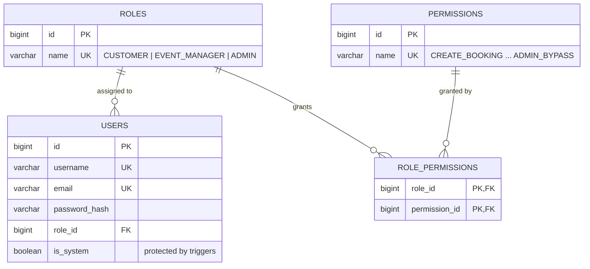
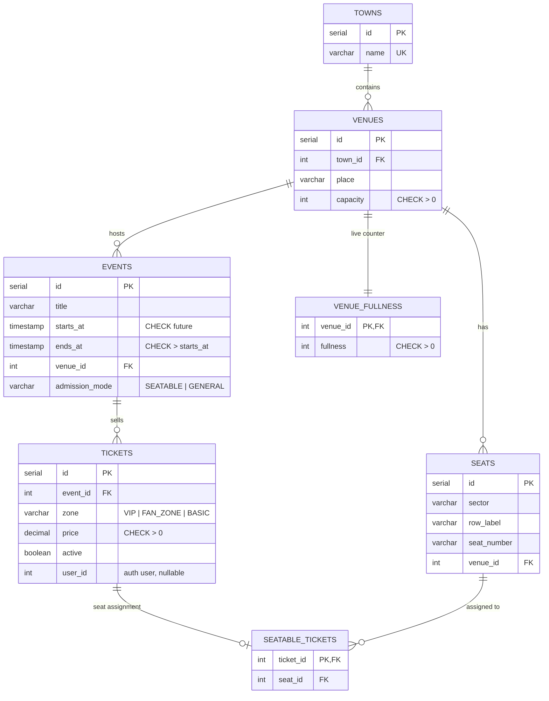
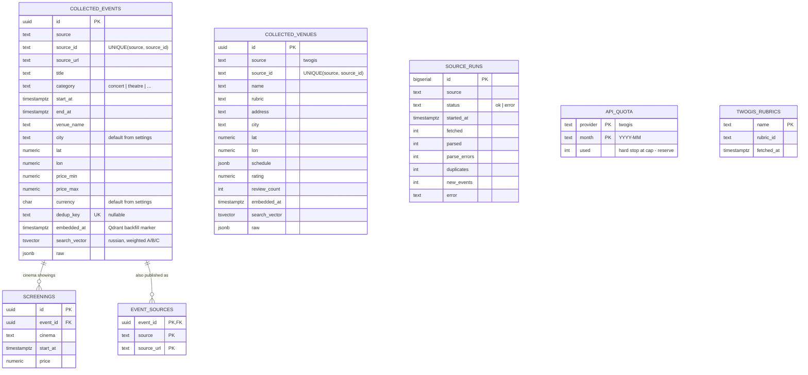
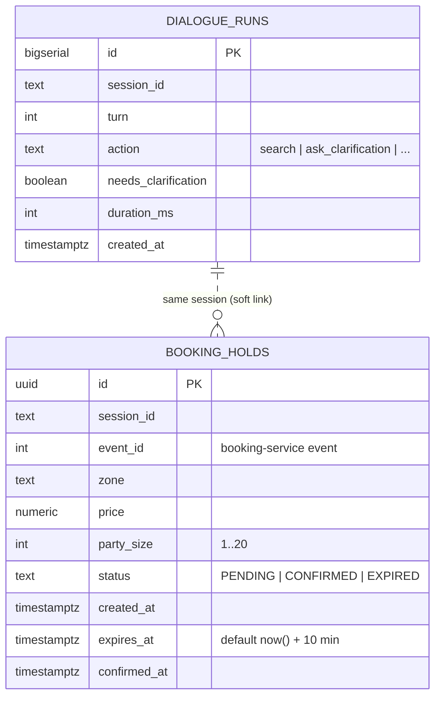
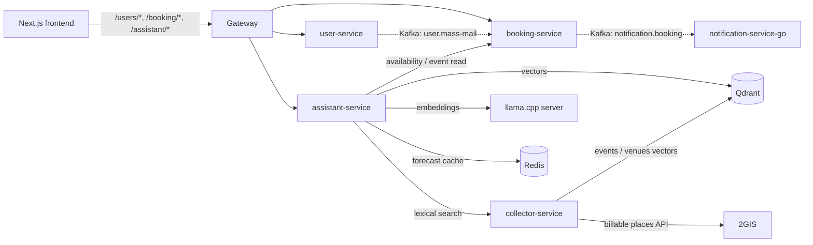

# Data model

Four PostgreSQL databases are provisioned by `init-postgres.sql`:
`user_service`, `booking_service`, `collector_db`, `assistant_db`.
Services never read each other's database — they integrate through HTTP and
Kafka. The diagrams below use UML/ER notation: `||--o{` is one-to-many,
`||--||` is one-to-one, `}o--||` is many-to-one.

The same diagrams are checked in as PlantUML sources under
[`docs/uml/`](uml/), so they can be rendered or reviewed without a browser.

---

## 1. `user_service` — identity and roles



Notes

- `role_permissions` is a pure join table; its primary key is the pair.
- Triggers forbid changing the role or deleting a user with `is_system = true`.
- `users.role_id` uses `ON DELETE RESTRICT`, so a role cannot disappear while
  it is still assigned.

---

## 2. `booking_service` — catalog, seats and tickets



Notes

- `seatable_tickets` is a 1:1 extension of `tickets` for seatable events;
  general-admission tickets have no row there.
- `uq_seats_venue_sector_row_number` prevents duplicate physical seats.
- Trigger `check_venue_fullness` increments `venue_fullness` before a ticket
  update and raises once capacity is exceeded.
- `active = true` is what the assistant asks for through
  `GET /booking/tickets/search?active=true`.

---

## 3. `collector_db` — scraped playbill, dedup and search



Notes

- `dedup_key` is a partial unique index: the same logical event coming from
  two sources is merged into one row, and `event_sources` keeps both URLs.
- `search_vector` is maintained by a trigger (title A, venue B, description C)
  and indexed with GIN — this is the lexical half of hybrid search.
- `source_runs` is append-only and drives `/collect/health`, alerting and the
  Prometheus counters. A failed fetch still writes a row.
- `api_quota` is consumed **per HTTP attempt** for billable providers and
  stops at `cap - reserve`, so the trial key never gets disabled mid-month.
- `collector_kv` (not drawn) caches the discovered 2GIS region id.

---

## 4. `assistant_db` — dialogue observability and booking intents



Notes

- `dialogue_runs` is write-only telemetry; it is truncated by tests and read
  by `GET /metrics`.
- `booking_holds` stores a **booking intent**, not real inventory:
  - one pending intent per `(session_id, event_id)` via the partial unique
    index `uq_booking_holds_pending`;
  - `CHECK` constraints keep `price >= 0` and `1 <= party_size <= 20`;
  - the expiry sweep flips stale `PENDING` rows to `EXPIRED`;
  - confirming a missing, taken or expired hold returns HTTP 410.
- Real ticket locking lives in booking-service and is deferred
  (`TODO(stage-3b)`, see [`docs/TODO.md`](TODO.md)).

---

## 5. Cross-service interactions



The data model is intentionally split per service: there are no cross-database
foreign keys, only ids exchanged in DTOs. `event_id` in `booking_holds` is a
booking-service id (integer); collected events use UUIDs and therefore never
get a live availability check.

---

## 6. UML class view (PlantUML sources)

Full class diagrams with attributes, methods and multiplicities:

| File | Scope |
| --- | --- |
| [`uml/user-service.puml`](uml/user-service.puml) | identity entities and repositories |
| [`uml/booking-service.puml`](uml/booking-service.puml) | catalog, tickets, services |
| [`uml/collector-service.puml`](uml/collector-service.puml) | adapters, services, repositories |
| [`uml/assistant-service.puml`](uml/assistant-service.puml) | dialogue, search engine, filters, holds |

Render them with any PlantUML jar or IDE plugin, for example:

```bash
plantuml -tsvg docs/uml/*.puml
```
